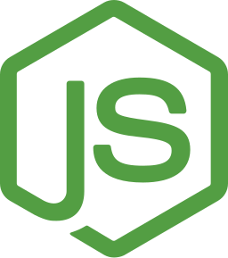
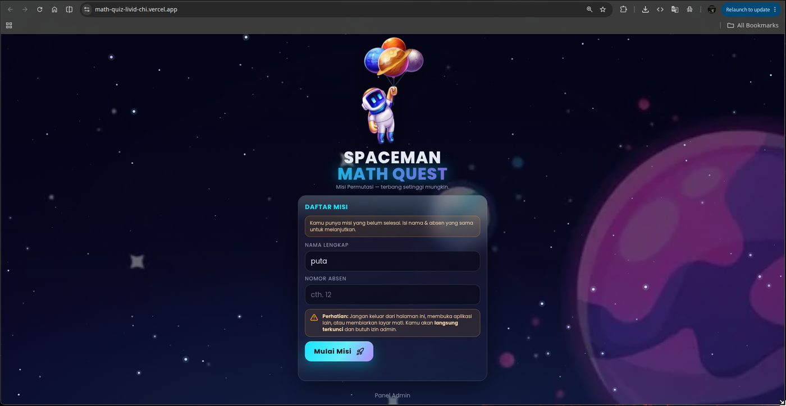
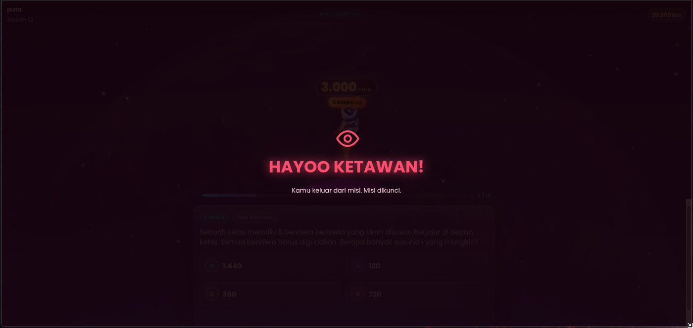
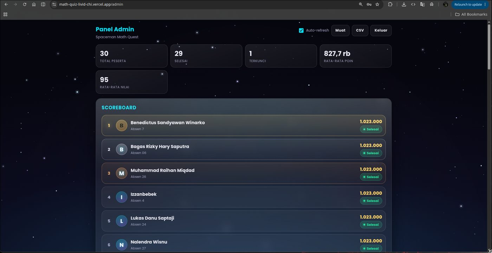
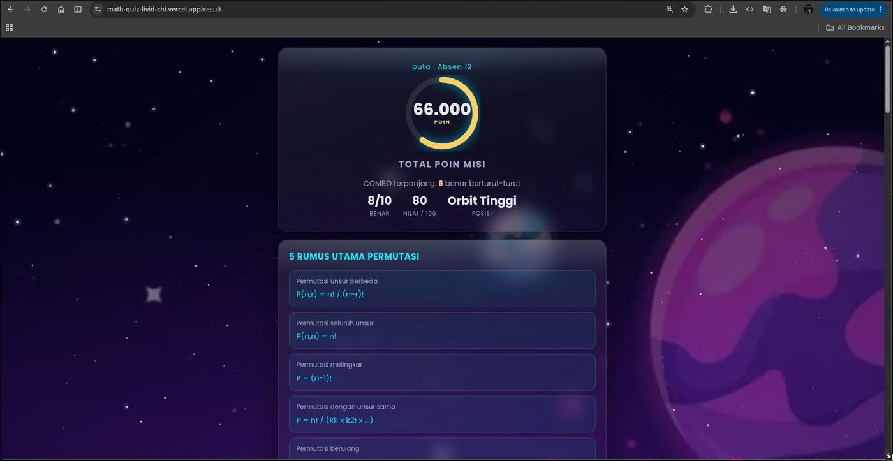

# Spaceman Math Quest — Kuis Permutasi

Platform kuis matematika interaktif bertema **astronot luar angkasa**. Siswa menjawab soal permutasi sambil menerbangkan astronotnya makin tinggi ke angkasa, sementara guru memantau seluruh progres secara real-time melalui panel admin.

Dibangun untuk berjalan **online** (Vercel + Turso) maupun **lokal** untuk simulasi di kelas.

## Fitur Utama

- **10 soal cerita Permutasi** dengan 4 pilihan ganda
- **Urutan soal & pilihan diacak** untuk setiap siswa
- **Astronot naik 10 tingkat** (10.000 → 100.000 km) setiap jawaban benar
- **Sistem Poin COMBO** — jawaban benar beruntun melipatgandakan poin ×2
- **Panel Admin** — scoreboard live, statistik, kelola peserta, ekspor ke Excel
- **Anti-Cheat** — keluar halaman / pindah tab / refresh akan memunculkan peringatan dan mengunci misi
- **Pembahasan Lengkap** — rumus dan langkah pengerjaan di halaman hasil

## Tech Stack

<div align="center">
  
  
  
  
  
  
  
  
</div>

| Teknologi | Keterangan |
| --- | --- |
|  HTML5 | Struktur halaman statis |
|  CSS3 | Tampilan bertema luar angkasa |
|  JavaScript | Logika frontend interaktif |
|  Node.js | Runtime server & serverless functions |
|  SQLite | Database lokal untuk mode pengembangan |
|  Turso | Database cloud untuk produksi |
|  Vercel | Hosting & deployment serverless |
|  GitHub | Version control & CI/CD |

---

## Tangkapan Layar

| Tampilan | Keterangan |
| --- | --- |
|  | Halaman awal untuk mengisi nama & absen |
|  | Tampilan soal, astronot, dan progress misi |
|  | Scoreboard & pengelolaan peserta |
|  | Total poin, nilai, dan pembahasan |

---

## Struktur Proyek

```
math-project/
├── api/                     # Vercel Serverless Functions
│   ├── start.js             #   daftar misi (nama + absen), cek duplikat
│   ├── state.js             #   status misi + soal aktif
│   ├── answer.js            #   kirim jawaban (divalidasi di server)
│   ├── violation.js         #   tandai pelanggaran -> kunci
│   ├── finish.js            #   selesaikan misi
│   ├── result.js            #   hasil + pembahasan
│   └── admin/               #   scores, unlock, reset, delete
├── lib/
│   ├── questions.js         # bank soal (teks, opsi, kunci, rumus, langkah)
│   ├── db.js                # Turso (produksi) / SQLite lokal (dev)
│   ├── game.js              # logika misi, penilaian, tingkat ketinggian
│   └── util.js              # helper respons, auth admin, dll
├── public/                  # Frontend statis (di-deploy Vercel)
│   ├── index.html           # landing / daftar misi
│   ├── quiz.html            # halaman kuis
│   ├── result.html          # halaman hasil & pembahasan
│   ├── admin.html           # panel admin
│   ├── css/style.css
│   ├── js/                  # app, quiz, result, admin, space, hud, api
│   └── assets/              # gambar & ikon
│       └── images/          # tangkapan layar untuk dokumentasi
├── dev-server.js            # server lokal untuk uji coba
├── vercel.json              # konfigurasi deploy Vercel
├── .env.example             # contoh environment variables
└── package.json
```

---

## Menjalankan Secara Lokal

Tanpa `TURSO_*`, aplikasi otomatis memakai **SQLite lokal** (`data/quiz.db`).

```bash
npm install
cp .env.example .env.local     # opsional: ubah ADMIN_PASSWORD
npm start                      # atau: node dev-server.js
```

Lalu buka:

- **Siswa** : http://localhost:3000
- **Admin** : http://localhost:3000/admin (password default `Krisna17#`)

Siswa lain di WiFi/hotspot yang sama dapat mengakses `http://<IP-laptop>:3000`
(IP ditampilkan otomatis di terminal saat server mulai).

---

## Deploy Produksi (Vercel + Turso)

### 1. Buat Database Turso

```bash
# Install Turso CLI (Linux/macOS)
curl -sSfL https://get.tur.so/install.sh | bash

turso auth signup          # atau: turso auth login
turso db create spaceman-math-quest
turso db show spaceman-math-quest --url      # -> TURSO_DATABASE_URL
turso db tokens create spaceman-math-quest   # -> TURSO_AUTH_TOKEN
```

### 2. Deploy ke Vercel

Cara termudah lewat dashboard:

1. Push proyek ini ke GitHub.
2. https://vercel.com/new → import repository.
3. Framework Preset: **Other** (biarkan otomatis; `vercel.json` sudah mengatur).
4. Sebelum deploy, buka **Environment Variables**, tambahkan:

| Name | Value |
| -------------------- | ------------------------ |
| `ADMIN_PASSWORD` | `Krisna17#` |
| `TURSO_DATABASE_URL` | `libsql://...turso.io` |
| `TURSO_AUTH_TOKEN` | token dari langkah 1 |

5. **Deploy**. Vercel otomatis menyajikan `public/` sebagai statis dan `api/` sebagai serverless function.

Atau lewat CLI:

```bash
npm i -g vercel
vercel login
vercel env add ADMIN_PASSWORD        # masukkan nilainya
vercel env add TURSO_DATABASE_URL
vercel env add TURSO_AUTH_TOKEN
vercel --prod
```

Setelah selesai:

- **Siswa** : `https://<nama-proyek>.vercel.app`
- **Admin** : `https://<nama-proyek>.vercel.app/admin`

> Halaman siswa dapat dibuka dari mana saja. Laptop guru tidak perlu menyala selama ujian.

---

## Aturan Permainan

| Aturan | Keterangan |
| --- | --- |
| **Poin (COMBO)** | Benar ke-n berturut-turut = `1.000 × 2^(n-1)`, maksimal 10 benar = **1.023.000 poin** |
| **Jawaban Salah** | Poin tidak berkurang, tetapi COMBO reset ke +1.000 |
| **Nilai** | 10 soal × 10 = **0–100** |
| **Ketinggian Astronot** | Naik 10 tingkat per jawaban benar (terpisah dari poin) |
| **Pembahasan** | Ditampilkan di halaman hasil, bukan saat mengerjakan |
| **Timer** | Tidak ada |
| **Suara** | Tidak ada |
| **Urutan Soal & Pilihan** | Diacak untuk setiap siswa |
| **Keluar / Pindah Tab / Refresh** | Muncul peringatan browser, misi terkunci, lanjut dari soal terakhir setelah diizinkan admin |
| **Setelah Selesai** | Ulang perlu izin admin |
| **Nama Duplikat** | Ditolak; admin harus menghapus data lama terlebih dahulu |

---

## Panel Admin

- Login menggunakan password (`ADMIN_PASSWORD`)
- **Statistik**: total peserta, selesai, terkunci, rata-rata poin, rata-rata nilai
- **Scoreboard** diurutkan berdasarkan poin tertinggi
- **Semua Peserta**: pencarian nama/absen, filter status, kolom Poin · Nilai · Streak
- **Aksi Peserta**: Izinkan Lanjut (untuk yang terkunci), Reset, Hapus
- **Ekspor Excel** dalam format `.xls` yang rapi
- **Auto-refresh** data setiap 8 detik

---

## Mengubah Soal

Semua soal berada di **`lib/questions.js`**. Contoh satu entri:

```js
{
  id: 1,
  text: 'Dalam sebuah lomba terdapat 8 peserta ...',
  options: ['56', '168', '336', '512'],
  answer: '336',                        // harus persis salah satu isi options
  rumus: 'P(n,r) = n! / (n-r)!',
  langkah: ['P(8,3) = 8! / (8-3)!', '= 8! / 5!', '= 8 x 7 x 6', '= 336'],
}
```

Ubah `ADMIN_PASSWORD` kapan saja lewat Environment Variables di Vercel
(atau `.env.local` saat lokal).

---

## Aset & Dokumentasi

Gambar-gambar untuk dokumentasi disimpan di folder:

```
public/assets/images/
├── landing.jpg    # tampilan halaman awal
├── quiz.jpg       # tampilan halaman kuis
├── admin.jpg      # tampilan panel admin
└── result.jpg     # tampilan halaman hasil
```

Screenshot disimpan sebagai **JPEG maks 1400px** agar ringan saat dibuka di GitHub
(total ±220 KB untuk 4 gambar). PNG resolusi penuh disimpan sebagai backup lokal di
`public/assets/images/_source/` (di-ignore, tidak ikut ke repo).

Untuk menambahkan tangkapan layar, simpan file di dalam folder tersebut, lalu rujuk
memakai path **relatif dari root repo** (README berada di root, jadi selalu diawali `public/`):

```md

```

> Jangan menulis `assets/images/...` tanpa `public/` — GitHub akan menampilkan
> ikon gambar rusak karena file-nya tidak ditemukan.

Ganti `solve.jpg` dengan nama file yang diinginkan. Setelah mengganti screenshot,
jalankan `python3 optimize-screenshots.py` untuk membuat versi ringannya.
